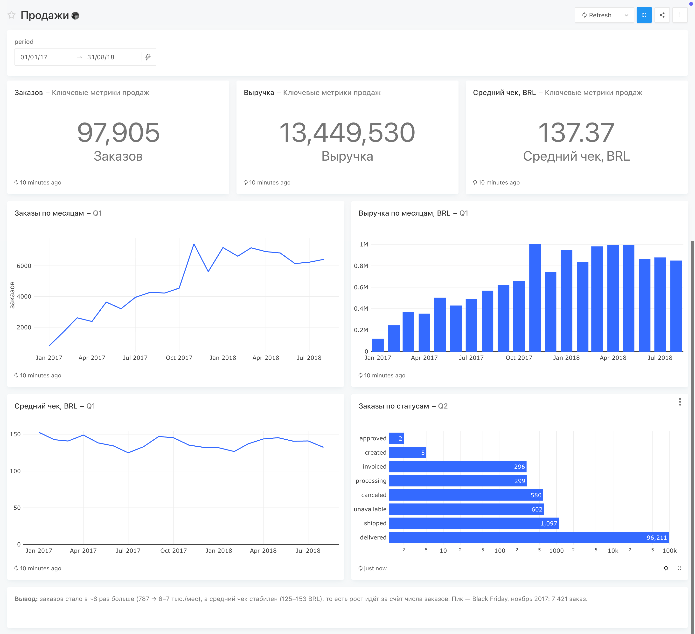
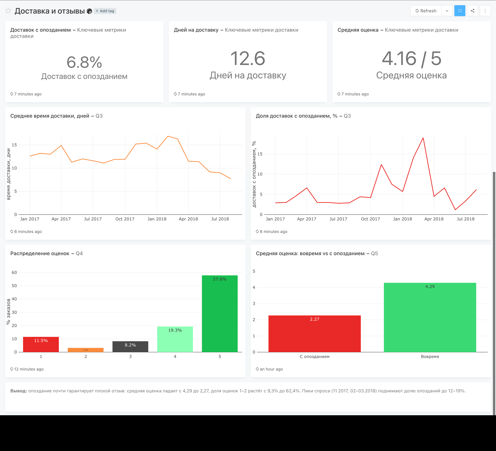

# Marketplace Analytics: продажи, доставка и отзывы (Olist)

Аналитика бразильского маркетплейса Olist: SQL на PostgreSQL и дашборды в Redash, через Docker.

**Стек:** PostgreSQL 16 · Redash 10 · Docker Compose · SQL (CTE, оконные функции)

## Вопросы

1. Как менялись число заказов, выручка и средний чек по месяцам?
2. Какая доля заказов отменяется или не доходит до покупателя?
3. Как часто доставка опаздывает и сколько дней она занимает?
4. Как распределены оценки покупателей?
5. Насколько опоздание доставки влияет на оценку?

## Данные

[Brazilian E-Commerce Public Dataset by Olist](https://www.kaggle.com/datasets/olistbr/brazilian-ecommerce) (Kaggle), ~100 тыс. заказов за 2016–2018. Используются 3 таблицы:

| Таблица | Строк | Что внутри |
|---|---|---|
| `orders` | 99 441 | статус и даты заказа: покупка, доставка, обещанная дата |
| `order_items` | 112 650 | позиции заказа: цена, стоимость доставки |
| `order_reviews` | 99 224 | оценки 1–5 |

**Особенности данных и их обработка**

- **Заказ ≠ позиция.** Заказ может содержать несколько товаров. Выручка берётся из `order_items`, но позиции предварительно агрегируются до уровня заказа, иначе число заказов завышается.
- **Несколько отзывов на заказ.** `review_id` не уникален, у части заказов по 2 отзыва. Для каждого заказа используется последний отзыв (`ROW_NUMBER()`), иначе JOIN с заказами дублирует строки.
- **Обещанная дата без времени.** `order_estimated_delivery_date` хранится как 00:00, поэтому опоздание определяется по календарным дням (`CAST(... AS date)`). Иначе доставка в обещанный день считалась бы опозданием.
- **Неполные месяцы.** 2016 год и сентябрь–октябрь 2018 содержат единичные заказы и дают ложный обвал на графиках. Анализ ограничен периодом 01.2017–08.2018.
- **Определения метрик.** Выручка — сумма `price` без стоимости доставки (`freight_value`) по заказам, кроме статусов `canceled` и `unavailable`. Средний чек — выручка / число заказов.

## Дашборды

### «Продажи» (фильтр по периоду)


### «Доставка и отзывы»


## SQL

| # | Запрос | Файл |
|---|---|---|
| Q1 | Заказы, выручка, средний чек по месяцам | [q1_sales_by_month.sql](sql/q1_sales_by_month.sql) |
| Q2 | Заказы по статусам | [q2_orders_by_status.sql](sql/q2_orders_by_status.sql) |
| Q3 | Доля опозданий и время доставки по месяцам | [q3_delivery_by_month.sql](sql/q3_delivery_by_month.sql) |
| Q4 | Распределение оценок 1–5 | [q4_review_distribution.sql](sql/q4_review_distribution.sql) |
| Q5 | Средняя оценка: вовремя vs с опозданием | [q5_score_ontime_vs_late.sql](sql/q5_score_ontime_vs_late.sql) |
| KPI | Карточки-счётчики для дашбордов | [kpi_sales.sql](sql/kpi_sales.sql), [kpi_delivery.sql](sql/kpi_delivery.sql) |

Загрузка данных: [00_load.sql](sql/00_load.sql).

## Выводы

1. **Рост идёт за счёт числа заказов, а не чека.** Заказов стало в ~8 раз больше: 787 в январе 2017 и 6–7 тыс. в месяц в 2018 году. Средний чек всё это время держится в коридоре 125–153 BRL. Пик продаж пришёлся на ноябрь 2017 (Black Friday): 7 421 заказ и 1,0 млн BRL выручки.
2. **Пики спроса ломают логистику.** В среднем опаздывает 6,8% доставленных заказов. Но в ноябре 2017 доля опозданий выросла до 12,4%, а в феврале–марте 2018 до 14–19%, при этом доставка занимала 16–17 дней против обычных 11–12. Ко второй половине 2018 года ситуация выправилась: в августе доставка шла 7,7 дня.
3. **Опоздание почти гарантирует плохой отзыв.** Средняя оценка при доставке вовремя 4,29, при опоздании 2,27. Доля оценок 1–2 растёт с 9,3% до 62,4%, то есть в 6,7 раза. Сокращение опозданий — самый прямой рычаг для рейтинга маркетплейса.

## Запуск

Нужен Docker Desktop. Скачать архив датасета с Kaggle в `~/Downloads/archive.zip`, затем:

```bash
cp .env.example .env   # вписать: openssl rand -hex 32
bash setup.sh          # read CSV, Postgres + Redash, load
```

Redash откроется на http://localhost:5050. Источник данных: PostgreSQL, host `db`, port `5432`, БД `olist`, пользователь и пароль из `.env`.
